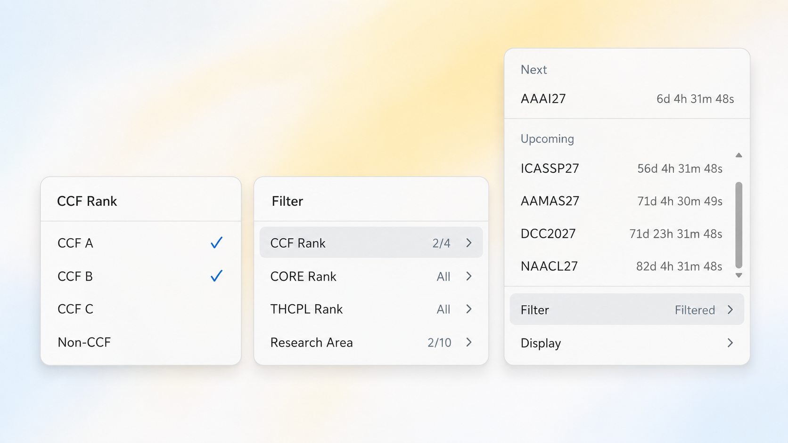

<div align="center">

# CCF DDL Tray

A lightweight Windows system-tray companion for tracking upcoming computer-science conference deadlines.

[](https://github.com/Gerard-Devlin/ccf-ddl-win-bar/releases/latest)
[](LICENSE)


[Download](https://github.com/Gerard-Devlin/ccf-ddl-win-bar/releases/latest) ·
[Report a bug](https://github.com/Gerard-Devlin/ccf-ddl-win-bar/issues/new) ·
[CCF Deadlines](https://ccfddl.com/)

<sub>Unofficial community extension. Conference data is provided by the upstream CCF Deadlines project.</sub>

</div>



## Overview

CCF Deadlines Tray keeps the next conference deadlines one hover away. Hover the notification-area icon for a temporary preview, or left-click to pin and focus the panel. Click again, press Esc, or switch windows to close it. Launching the app again opens the existing instance.

The application reads the dataset published by [CCF Deadlines](https://github.com/ccfddl/ccf-deadlines), converts deadline time zones locally, and caches the last successful response for offline use.

## Highlights

- **Hover preview and pinning** — preview quickly, or keep the panel open for mouse and keyboard interaction.
- **Live countdowns** — remaining time updates every second.
- **Complete deadline details** — inspect abstract, submission, cycle, source-time, and local-time information.
- **Fast filtering** — filter by CCF, CORE, THCPL, and research area.
- **Direct conference links** — select a conference to open its official website.
- **Flexible display** — choose the date range, visible item count, and system, dark, or light appearance.
- **Windows integration** — optional launch at startup, single-instance behavior, multi-monitor support, and taskbar-aware placement.
- **Offline recovery** — preserve loaded data on refresh failure, restore the local cache on restart, and retry manually.
- **No accounts or telemetry** — preferences remain on the current Windows account.

## Install

### DynamicWin UI edition

The independent [Windows Island project](windows-island) reuses DynamicWin's
original SkiaSharp controls, Inter fonts, icons, layout, and spring animations,
with CCF conference names and deadline countdowns replacing the widget content.
Its UI source is the public `main` branch at `9f24d17`; DynamicWin's current `V2`
branch hosts releases without source code.

The tray application below remains available separately. See the island's
[build and usage instructions](windows-island/README.md) for its standalone x64
installer, preview, keyboard controls, data cache, and source attribution.

### Installer

1. Download the newest NSIS installer from [GitHub Releases](https://github.com/Gerard-Devlin/ccf-ddl-win-bar/releases/latest).
2. Run the installer.
3. Find **CCF Deadlines** in the Windows notification area. If Windows hides the icon, open the tray overflow menu and pin it.

Community builds are currently unsigned, so Windows SmartScreen may ask for confirmation. The installer uses the current-user installation mode and does not require administrator access.

### Requirements

- Windows 10 or Windows 11
- An internet connection for refreshing conference data
- Microsoft Edge WebView2 Runtime

WebView2 is included with current Windows installations. When it is missing, the installer can download the bootstrapper automatically.

## Use

1. Hover over the tray icon to show the deadline panel.
2. Move the pointer into the panel to keep it open.
   Left-click the tray icon or use **Pin** to keep it open after moving the pointer away.
3. Hover over a conference row to see every upcoming deadline in both its source timezone and your local timezone.
4. Select a conference to open its official website.
5. Use **Filter** to narrow the list by ranking system or research area.
6. Use **Display** to change the date range, item count, color mode, or startup behavior.
7. Use **Refresh / Retry** in the footer to update immediately. Hover the status for the full error and last-update timestamp.
8. Right-click the tray icon for **Show**, **Refresh**, or **Exit CCF Deadlines**.

## Filters and display

| Setting           | Available options                                                                                                     |
| ----------------- | --------------------------------------------------------------------------------------------------------------------- |
| CCF Rank          | A, B, C, Non-CCF                                                                                                      |
| CORE Rank         | A\*, A, B, C, Non-CORE                                                                                                |
| THCPL Rank        | A, B, Non-THCPL                                                                                                       |
| Research Area     | AI, databases, software engineering, security, graphics, systems, networks, theory, HCI, and interdisciplinary topics |
| Deadline Range    | 30, 90, 180, or 365 days                                                                                              |
| Items Shown       | 3, 4, 5, 10, 20, or 50                                                                                                |
| Color Mode        | System, Dark, or Light                                                                                                |
| Launch at Startup | On or Off                                                                                                             |

Filter and display preferences are stored locally for the current Windows account.

## Data and privacy

The application downloads the combined conference dataset from:

1. `https://ccfddl.com/conference/allconf.yml`
2. `https://ccfddl.github.io/conference/allconf.yml` as a fallback

Data is fetched when the application starts and refreshed every 10 minutes. Failed HTTP requests or YAML parsing fall back to the mirror. A failed refresh preserves the last successful data and timestamp. Countdown values are calculated locally; expired abstract deadlines advance to the next submission or cycle, and editions with no future deadline disappear.

The application has no account system, analytics, advertising, or telemetry. It does not upload personal information. Selecting a conference only opens its official URL in the default browser.

## Run from source

Install the following development tools:

- [Rust](https://www.rust-lang.org/tools/install) with the `x86_64-pc-windows-msvc` target
- [Microsoft Visual Studio Build Tools](https://visualstudio.microsoft.com/visual-cpp-build-tools/) with **Desktop development with C++**, MSVC, and a Windows SDK
- Microsoft Edge WebView2 Runtime

Clone the repository and run:

```powershell
git clone https://github.com/Gerard-Devlin/ccf-ddl-win-bar.git
cd ccf-ddl-win-bar
cargo run --manifest-path .\windows-tray\src-tauri\Cargo.toml
```

## Build and test

Install the Tauri CLI:

```powershell
cargo install tauri-cli --version "=2.11.4" --locked
```

Run the Rust test suite:

```powershell
cargo test --manifest-path .\windows-tray\src-tauri\Cargo.toml --locked
```

Build the NSIS installer:

```powershell
cd windows-tray
cargo tauri build --bundles nsis --ci --no-sign -- --locked
```

The installer is generated under:

```text
windows-tray\src-tauri\target\release\bundle\nsis\
```

The [Windows build workflow](.github/workflows/build.yml) runs the same tests and installer build on every push and pull request. Successful runs publish the installer as a GitHub Actions artifact.

## Project structure

```text
.
|-- .github/
|   `-- workflows/
|       `-- build.yml       Windows test and installer workflow
|-- docs/
|   `-- preview.png         Project preview
|-- windows-tray/
|   |-- src-tauri/          Rust backend, tray integration, networking, and packaging
|   `-- ui/                 HTML, CSS, and JavaScript for the popover interface
|-- windows-island/         DynamicWin UI edition, conference data, and installer
|-- LICENSE
`-- README.md
```

This repository intentionally contains only the Windows tray extension. Website code, conference records, calendar feeds, and other extensions remain in the upstream [ccfddl/ccf-deadlines](https://github.com/ccfddl/ccf-deadlines) repository.

## Contributing

Issues and pull requests are welcome.

- Report Windows tray bugs and interface requests in [this repository](https://github.com/Gerard-Devlin/ccf-ddl-win-bar/issues).
- Submit incorrect conference dates, rankings, or links to the [upstream CCF Deadlines repository](https://github.com/ccfddl/ccf-deadlines).
- Keep pull requests focused and include screenshots for visible interface changes.
- Run the Rust tests before submitting code changes.

## Acknowledgements

- [CCF Deadlines](https://github.com/ccfddl/ccf-deadlines) for the conference dataset and the original project.
- [Tauri](https://tauri.app/) for the lightweight Windows desktop framework.

## License

The tray application is distributed under the [Apache License 2.0](LICENSE).
The DynamicWin-derived island edition has its own
[CC BY-SA 4.0 license](windows-island/LICENSE) and
[third-party notices](windows-island/NOTICE.md).
