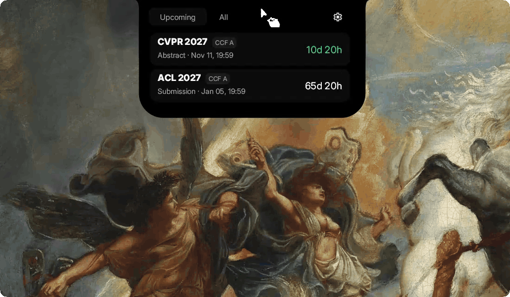

<div align="center">

# CCF Deadline Island

CCF conference deadlines in a compact desktop island for Windows.

 [](https://github.com/Gerard-Devlin/ccf-ddl-win-bar/actions/workflows/build-island.yml)

[Download for Windows](https://github.com/Gerard-Devlin/ccf-ddl-win-bar/releases/download/island-v0.1.8/CCF-Deadline-Island_0.1.8_x64-setup.exe) · [Release notes](https://github.com/Gerard-Devlin/ccf-ddl-win-bar/releases) · [Report an issue](https://github.com/Gerard-Devlin/ccf-ddl-win-bar/issues/new)

</div>

<p align="center">
  
</p>

## Features

- **Deadline overview** — See the next three conferences at a glance, or browse the full list of upcoming deadlines.
- **Conference filters** — Filter by CCF rank, research area, and date range, with an option to show submission deadlines only.
- **Deadline details** — Review abstract and submission dates in both local and source time zones, copy deadline information, and open official conference websites.
- **Followed conferences** — Keep conferences of interest highlighted, with your selections saved between sessions.
- **Offline access** — View the last successful dataset when offline. Automatic background refresh keeps the schedule up to date when connected.

## Installation

1. Download the [Windows x64 installer](https://github.com/Gerard-Devlin/ccf-ddl-win-bar/releases/download/island-v0.1.8/CCF-Deadline-Island_0.1.8_x64-setup.exe).
2. Run the installer, then launch **CCF Deadline Island** from the Start menu.
3. Enable **Launch at startup** in Settings if you want it available when you sign in.

Supports Windows 10 and 11. The installer includes the required runtime. When updating, exit the running application from its notification-area menu first.

## Usage

The island stays centered at the top of your primary display. Hover to expand it, click to keep it open, and select a conference to view its deadlines. Open Settings using the gear icon to adjust filters and startup behavior.

Followed conferences have green countdowns. Other deadlines turn red during their final 24 hours.

| Shortcut | Action |
| --- | --- |
| `Ctrl` + `Alt` + `D` | Expand or collapse the island |
| `Esc` | Collapse the island |
| `F5` | Refresh conference data |
| `Tab` / `Shift` + `Tab` | Navigate controls |
| `Enter` / `Space` | Activate the focused control |

## Development

Development requires Windows and the .NET 8 SDK. Building an installer also requires NSIS 3.

```powershell
dotnet run --project windows-island/CcfDeadlineIsland.csproj
./windows-island/Build.ps1
```

See the [development guide](windows-island/README.md) for build options, tests, and project details.

## Credits and license

Conference data is provided by [CCF Deadlines](https://github.com/ccfddl/ccf-deadlines). The interface is adapted from [DynamicWin](https://github.com/FlorianButz/DynamicWin) by Florian Butz.

Licensed under [CC BY-SA 4.0](LICENSE). See [NOTICE](NOTICE.md) for attribution and third-party licenses.
