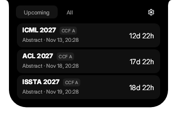

# CCF Deadline Island

Windows 灵动岛版 CCF 截止时间工具。界面直接使用
[DynamicWin](https://github.com/FlorianButz/DynamicWin) 的黑色外壳、Inter 字体、图标和弹簧动画，
以最近三场会议及截止时间为主界面。



0.1.2 移除底部状态/刷新整行，修复置顶和选中会议的收起显示，并补齐领域筛选与详情操作图标。
0.1.3 中，**All** 列表按实际会议条数收缩，最多显示五行，避免不足五场时留下空白。
验收记录见 [QA-0.1.2](docs/QA-0.1.2.md)。

上游默认 `V2` 分支只提供发行文件。本项目使用其公开 `main` 分支的源码，固定在
`9f24d176a16333b1cfda21dd3ed48087497194ed`；63 个原始源码/资源文件及许可证位于
`Upstream/DynamicWin`，逐文件 SHA-256 见 `VENDOR-MANIFEST.json`。这不是对闭源 V2 的源码移植。

## 使用

- 悬停展开；点击固定。`Esc` 收起，`Ctrl+Alt+D` 展开/收起。
- 固定在 Windows 主显示器的顶部中心；显示器、DPI 或任务栏变化后自动重算位置。
- 持续置顶，其他屏幕的全屏窗口不会让灵动岛自动隐藏；收起状态跟随所选会议。
- 点击会议行查看详情，详情中的 **Website** 打开官网。`F5` 刷新。
- `Tab` / `Shift+Tab` 切换控件，空格或 `Enter` 激活；筛选复选框文字与方框均可点击。
- 等级、研究领域、时间范围和仅投稿筛选即时保存；领域支持 **All / Clear**。
- **Display** 中单独设置动画，**Reset** 仅重置筛选。
- 数据每十分钟刷新，支持镜像回退和离线缓存；摘要截止后自动切换到下一有效截止。
- 详情可复制时间并导出 `.ics` 日历文件。

安装包为 Windows x64 自包含版本，无需另装 .NET。安装到
`%LOCALAPPDATA%\Programs\CCF Deadline Island`，开始菜单中可打开应用；托盘菜单可显示、刷新或退出。
卸载保留 `%LOCALAPPDATA%\CCFDeadlineIsland` 下的设置和缓存。

## 开发与构建

需要 Windows、.NET 8 SDK，以及 NSIS 3（仅生成安装包时需要）。以下命令从仓库根目录运行：

```powershell
dotnet run --project windows-island/CcfDeadlineIsland.csproj
./windows-island/Build.ps1
```

脚本优先使用仓库内 `.tools/dotnet/dotnet.exe`，其次使用 PATH 上的 SDK。NSIS 可通过
`MAKENSIS` 指定，也会查找 PATH、Tauri 缓存和标准 NSIS 安装目录。构建不会启动应用或安装程序。

输出：

```text
artifacts/windows-island-0.1.3/
artifacts/CCF-Deadline-Island_0.1.3_x64-setup.exe
```

`./windows-island/Build.ps1 -PublishOnly` 只生成自包含应用。分发整个输出目录，以保留字体、图标和许可证文件。

## 检查

```powershell
dotnet run --project windows-island/Tests/Island.Tests.csproj -c Release
# 可选：额外检查实时 CCF 数据
dotnet run --project windows-island/Tests/Island.Tests.csproj -c Release -- --live
# 用生产控件离屏生成预览及交互检查结果，不打开桌面窗口
dotnet 'windows-island/bin/Release/net8.0-windows/CCF Deadline Island.dll' --render-preview artifacts/ui-checks
```

发布后的单文件 EXE 也支持 `--render-preview <输出目录>`。输出包括 `preview.png`、各界面 PNG、
`geometry.json` 和 `checks.txt`。界面检查通过 WPF 路由的按下/抬起事件验证命中与捕获，
并覆盖键盘、快速点击、隐藏控件和数据变化。数据测试不依赖桌面 UI；实时数据检查不写入正式缓存。

## 来源与许可

DynamicWin 由 Florian Butz 开发，使用 CC BY-SA 4.0。本子项目保留相同许可及来源声明；
详见 [LICENSE](LICENSE)、[NOTICE.md](NOTICE.md) 和 `licenses/`。会议数据来自
[CCF Deadlines](https://github.com/ccfddl/ccf-deadlines)。本项目与 DynamicWin、CCF 均无隶属关系。
